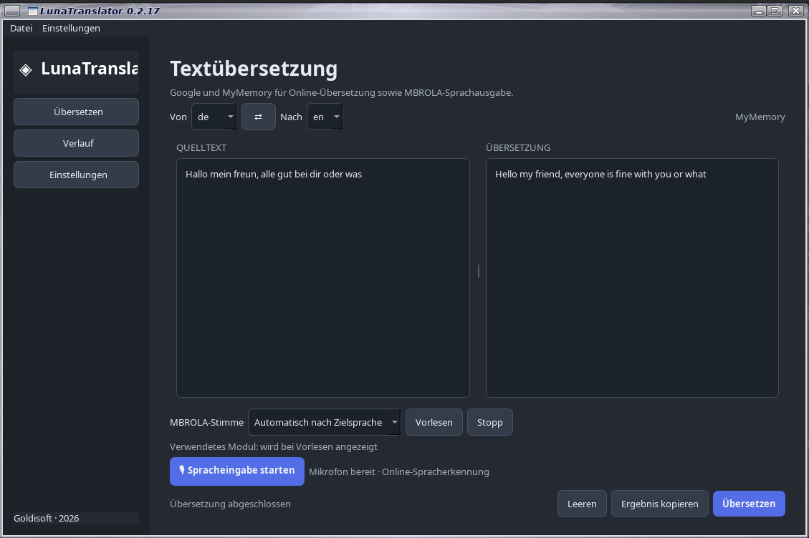

# LunaTranslator 0.2.18

LunaTranslator ist eine grafische Übersetzungsanwendung für Debian 13 (Trixie) und ARM64, entwickelt mit Python und Qt 6 / PySide6.

## Online-Übersetzungsdienste

- **Google Übersetzer** – Online-Übersetzung über den öffentlichen Google-Endpunkt.
- **MyMemory** – Online-Übersetzung über die MyMemory-API.

Beide Dienste können in der Anwendung separat ausgewählt werden. Bei Fehlern von MyMemory wird **nicht automatisch auf Google gewechselt**.



[Github Seite](https://github.com/Angonikro/LunaTranslator/)

## Funktionen

- Moderne Oberfläche im Graphit-Stil
- Google- und MyMemory-Onlineübersetzung
- Übersetzungsverlauf in einer lokalen SQLite-Datenbank
- Lokal gespeicherte Einstellungen
- Deutsche Kontextmenüs
- Sprachausgabe mit eSpeak NG und optional MBROLA
- Auswahl von Audiogerät, Audioausgabe und Mikrofon
- Spracheingabe über SpeechRecognition und Googles Online-Spracherkennung (optional)

## Installation unter Debian 13 – ohne virtuelle Umgebung

Die normale Installation verwendet die von Debian bereitgestellten Python-Pakete. Eine virtuelle Umgebung (`venv`) wird **nicht** angelegt und ist für die DEB-Installation nicht erforderlich.

```bash
sudo apt update
sudo apt install ./lunatranslator_0.2.18_all.deb
```

Start über das Anwendungsmenü oder im Terminal:

```bash
lunatranslator
```

Falls die DEB-Datei nicht im aktuellen Verzeichnis liegt, den Pfad entsprechend anpassen.

## Aus dem Quellcode starten – ohne venv

Benötigte Systempakete installieren:

```bash
sudo apt update
sudo apt install python3 python3-pyside6.qtwidgets python3-requests python3-pyaudio
```

Dann im entpackten Quellverzeichnis starten:

```bash
python3 main.py
```

Die optionale Spracheingabe benötigt zusätzlich das Python-Modul `SpeechRecognition`. Falls es als Debian-Paket verfügbar ist, kann es über APT installiert werden. Die Anwendung startet auch ohne dieses optionale Modul; nur die Spracheingabe steht dann nicht zur Verfügung.

## Alternative: Start in einer virtuellen Umgebung (venv)

Wer die Python-Abhängigkeiten lieber getrennt vom System installieren möchte, kann optional eine virtuelle Umgebung verwenden. Die Qt-/Audio-Systembibliotheken sollten weiterhin über APT installiert werden.

```bash
sudo apt update
sudo apt install python3-venv python3-pyside6.qtwidgets python3-pyaudio
python3 -m venv .venv --system-site-packages
. .venv/bin/activate
python -m pip install -r requirements.txt
python main.py
```

`--system-site-packages` ermöglicht den Zugriff auf die über Debian installierten PySide6- und PyAudio-Pakete. Die venv ist nur eine Alternative und wird durch die DEB-Installation nicht erstellt.

## Einstellungen und Verlauf

- Einstellungen: `~/.config/LunaTranslator/settings.json`
- Übersetzungsverlauf: `~/.local/share/LunaTranslator/history.sqlite3`

## Datenschutz und Protokollierung

LunaTranslator schreibt **keine Übersetzungs-Diagnoseprotokolle**. Insbesondere werden keine MyMemory-Anfragen, eingegebenen Texte, Übersetzungen, HTTP-Antworten oder Fehler in einer Diagnose-Logdatei gespeichert. Es wird keine Datei `~/.cache/LunaTranslator/mymemory-diagnostic.log` angelegt.

Der Übersetzungsverlauf ist davon getrennt: Er wird lokal in der oben genannten SQLite-Datenbank gespeichert und kann innerhalb der Anwendung verwaltet werden.

## Hinweise zu Online-Diensten

Für Google und MyMemory ist eine Internetverbindung erforderlich. Google verwendet einen öffentlichen, nicht offiziell garantierten Web-Endpunkt ohne API-Schlüssel. MyMemory hat ein begrenztes kostenloses Tageskontingent.

## Optionale Sprachausgabe mit MBROLA

```bash
sudo apt install espeak-ng mbrola mbrola-de1 mbrola-en1 alsa-utils
```

Für weitere Sprachen können passende MBROLA-Stimmen installiert werden, zum Beispiel `mbrola-fr1`, `mbrola-it1`, `mbrola-nl1` oder `mbrola-es1`. Die Stimmen sind separate Debian-Pakete und nicht Bestandteil von LunaTranslator. Wenn keine passende MBROLA-Stimme installiert ist, verwendet die Anwendung die native eSpeak-NG-Stimme der Zielsprache.

Die Audiowiedergabe nutzt eine temporäre WAV-Datei und unterstützt PipeWire (`pw-play`), PulseAudio (`paplay`) und ALSA (`aplay`).

## Spracheingabe

Die optionale Spracheingabe nimmt Ton über SpeechRecognition/PyAudio auf und verwendet Googles Online-Spracherkennung. Dafür sind eine Internetverbindung und das optionale Python-Modul `SpeechRecognition` erforderlich. Die Audiodaten werden zur Erkennung an Google übertragen. Die ausgewählte Quellsprache bestimmt die Erkennungssprache (zum Beispiel `de-DE`).

73 de DO2QG Andreas
